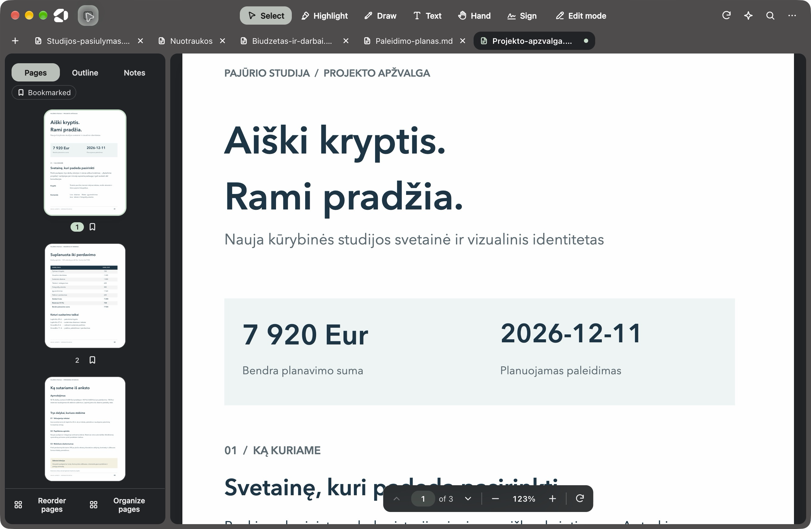
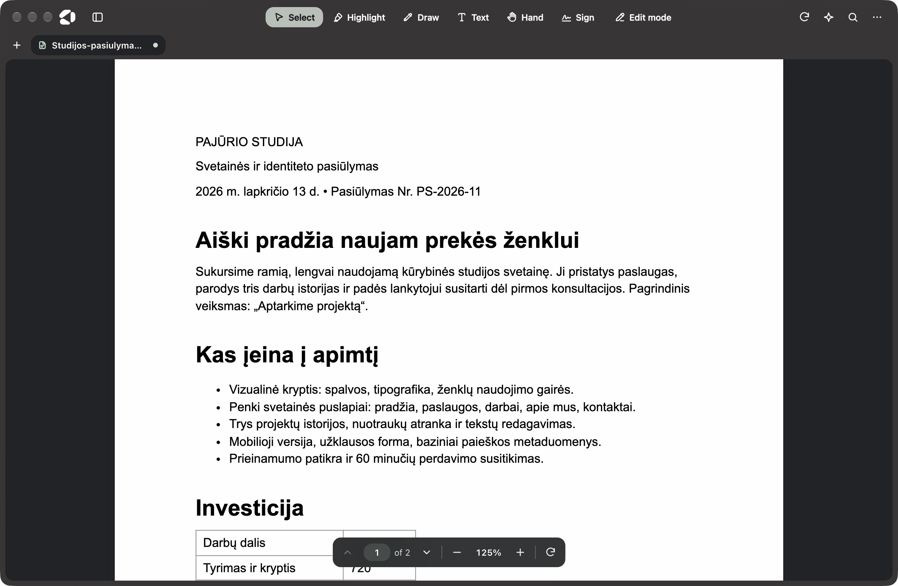
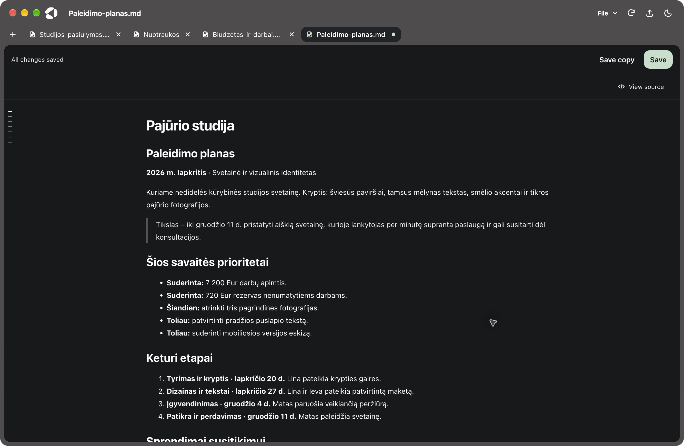
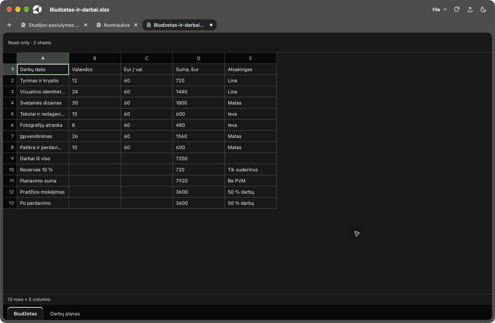
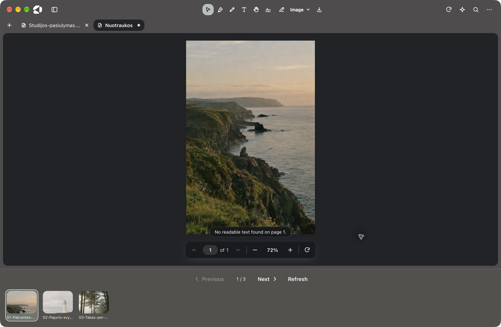
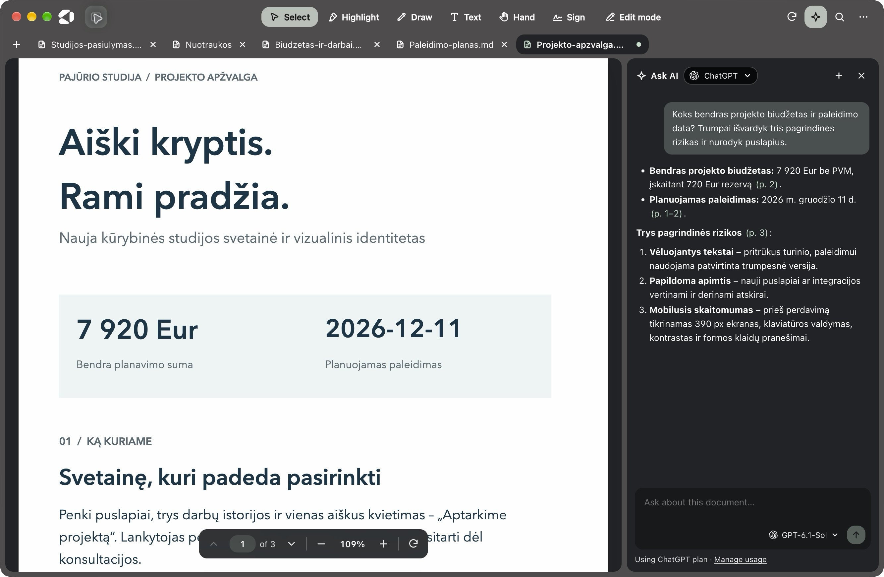

# Doko

A fast, clean PDF reader for Windows, macOS, and Linux. Read, highlight, annotate, sign, and ask AI about your
documents. Free and open source, with no Doko account required.

## Doko in everyday use

One fictional **Pajūrio studija** project, opened in the installed Doko app: a PDF brief, Word proposal,
Markdown plan, Excel budget, photo folder, and a real Ask AI conversation.

| PDF reading | Word → PDF |
| --- | --- |
|  |  |

| Markdown | Excel workbook |
| --- | --- |
|  |  |

| Photo gallery | Ask AI |
| --- | --- |
|  |  |

[Capture provenance and refresh instructions](docs/screenshots/README.md).

## Download

| Platform | Download | Updates |
| --- | --- | --- |
| **Windows** 10/11 (64-bit) | [Doko for Windows](https://github.com/roqusanalytics/doko/releases/latest) | Automatic |
| **macOS** 12 or later (Apple Silicon and Intel) | [Doko for macOS](https://github.com/roqusanalytics/doko/releases/latest) | Doko tells you when a new version is out |
| **Linux**: Ubuntu, Debian, and derivatives (64-bit) | [Doko for Debian/Ubuntu](https://github.com/roqusanalytics/doko/releases/latest) | Automatic, with your system updates (apt) |
| **Linux**: other distributions (64-bit) | [Doko for Linux](https://github.com/roqusanalytics/doko/releases/latest) | Automatic |

[All releases](https://github.com/roqusanalytics/doko/releases) · [Changelog](CHANGELOG.md) · Prefer not to
install on Windows? [Doko portable](https://github.com/roqusanalytics/doko/releases/latest) runs as-is (it doesn't auto-update).

Choose the installer for your platform from the latest release. Until the first Doko release, the available builds
are still named `Folio-*`; new releases use `Doko-*`. Use the downloaded filename in the Linux commands below.

Doko's builds aren't signed with paid developer certificates yet, so the first launch needs one extra step:

- **Windows:** if SmartScreen warns, choose **More info → Run anyway**.
- **macOS:** open the DMG and drag Doko to Applications. The first time you open it, macOS says it can't verify the
  developer: click **Done**, then go to **System Settings → Privacy & Security** and click **Open Anyway**.
- **Linux (.deb):** `sudo apt install ./Doko-linux-amd64.deb`, then open the reader from your applications menu. The
  package adds Doko's signed apt repository, so new versions arrive with your regular system updates (or
  `sudo apt update && sudo apt upgrade`). Copies installed from a .deb before 1.9 need the new .deb installed once.
- **Linux (AppImage):** make it executable (`chmod +x Doko-linux-x86_64.AppImage`) and run it. AppImages need FUSE 2:
  `sudo apt install libfuse2t64` on Ubuntu 24.04 or later, `libfuse2` on older releases.

Or build Doko yourself from source (below).

## Compatibility with existing installs

Doko is the rebranded continuation of [Forward-Future/folio](https://github.com/Forward-Future/folio). Existing installs and update data keep their original identifiers: `FOLIO_*` environment variables, `app.folio.local`, the internal `Folio Local` credential-store name and profile, Linux `folio-local` package/executable/apt paths and key filenames, and the Windows `FolioLocal` ProgID. User data also remains in the existing `%APPDATA%\Folio Local`, `~/Library/Application Support/Folio Local`, and `~/.config/Folio Local` folders. This keeps current installs and their updates working; new Doko installs use `/Applications/Doko.app` on macOS.

## Features

### Open PDFs and web links

- **Document tabs.** Pick or drop several PDFs together, or choose **More → New tab**. The tab strip appears beneath
  the toolbar when two or more tabs are open. Each document keeps its page, zoom, and edits when you switch.
- **PDF URLs:** choose **Open from URL** (`Ctrl+Shift+O`), or drop a link or paste it with `Ctrl+V` outside a text
  field to fill it in, then press **Open**. Doko downloads and opens the PDF, follows redirects, and uses the server's
  filename when available. Doko asks once more before opening an address on your computer or local network.
- **Webpage to PDF:** use the same URL workflow for a webpage. Doko converts it into a PDF with selectable text,
  ready for highlights, notes, and Ask AI. The conversion preserves the site's on-screen layout, backgrounds,
  transparency, colors, and images instead of switching to its print styles.
- **Word documents to PDF:** open a `.docx` or `.doc` file the same ways as a PDF (**Open with → Doko**, the file
  picker, or drag and drop). Doko opens the PDF and saves a private copy beside the original when possible
  ("Report.docx" gets "Report.pdf"). Occupied names get a number. Reopening reuses a copy only if both files still
  match Doko's conversion record. Opening a symbolic link, or a file on a separate volume on macOS, skips the
  automatic save. Doko converts with
  Microsoft Word on Windows when it's installed, otherwise with LibreOffice, otherwise with its own converter for
  `.docx` (text, headings, lists, tables, and images, in a simpler layout). `.doc` files need Word or LibreOffice,
  except on macOS. Installing Doko adds it to **Open with** for Word documents without making it their default app.
- **Password-protected PDFs:** enter the password to read and annotate a protected document. These documents are not
  kept in the recent library, and their annotations and AI conversations are not persisted locally between sessions.
- **Sample document:** try the built-in tour from the home screen without finding a PDF first.

URL opening, webpage conversion, and Word conversion require the desktop app. Failed downloads leave your current document open.

### Capture a screen area

Click the screenshot icon at the right of the document tabs, then drag from any corner to select a desktop area.
The selected PNG is copied to the clipboard. Choose **Save…** to keep a PNG, **Draw** to annotate it in Doko, or
**Retake** to select again. After editing, **Copy image** includes your drawings and text; **Save PNG** saves a copy.
Press **Esc** to cancel; **Enter** captures the displayed screen area without a mouse. Paste a copied image into a
PDF with your platform's Paste shortcut, then save a PDF copy to keep it.

Screen capture is desktop-only and processed locally. macOS requires Screen & System Audio Recording permission
for Doko in System Settings → Privacy & Security; reopen Doko after granting it. Linux with PipeWire offers the
screen chosen in the system picker rather than every monitor at once.

### Edit photos and PDF copies

- **Photos → Image → Crop, resize and adjust:** drag a crop region, choose its aspect ratio, rotate or flip,
  enter exact pixel dimensions with proportional sizing, and adjust brightness, contrast and saturation.
  Preview changes, Undo or Reset, then Apply. **Save PNG** saves a separate edited image; existing marks become part of its pixels.
- **Pages → Organize pages** (also in **More**): insert a PDF or blank page before/after selected thumbnails,
  rotate or delete multiple pages, Undo, then Apply. Original files stay unchanged. Imported document-level bookmarks
  and accessibility tags stay in the source. PDFs with imported form fields or unsupported page structures show an explanation.
- **Selected text → Text marking style:** choose Highlight, Underline or Strike through. The latter two are real PDF annotations.
- **More → Redact content:** mark areas and explicitly confirm a sanitized copy. Every page becomes a flat image at
  144 DPI; searchable text, forms, links, metadata and attachments are removed from the copy. Use an unsigned, unencrypted PDF.
- **More → Protect PDF copy:** set and confirm an opening password, then save an AES-256 encrypted copy. Passwords are not saved in preferences.
- **Undo edit** reverses the latest applied document operation while preserving newer document notes and surviving page bookmarks.
  Finish content editing before using it. Original source files are changed only through an explicit native save choice.

### Read and navigate

- **Back and Forward:** after following an internal link or an outline entry, choose **More → Back** to return to
  your place. The first jump also shows a brief, clickable Back hint. **More → Forward** appears after you go back.
  Each tab remembers its own positions, zoom, and rotation until the document closes. Use **Alt+← / Alt+→**
  (**⌥← / ⌥→** on macOS) while reading. Text fields and dialogs keep their normal editing controls.
- **Continuous scrolling** with selectable text, previous/next controls, and a page-number field for jumping directly
  to a page. Enable **Settings → General → Reading → Scroll one page at a time** to turn pages with the mouse wheel.
- **Pages and Outline tabs:** browse page thumbnails or the PDF's existing outline/bookmarks; hide the sidebar when
  you want more reading space.
- **Personal bookmarks:** click the ribbon beside a page number in **Pages** to save or remove a bookmark without
  leaving your current page. Turn on **Bookmarked** at the top of the sidebar to see just your saved pages,
  then select a thumbnail to jump to it. These bookmarks are included in Markdown and JSON exports. Doko remembers them locally
  when you reopen a PDF, except for password-protected documents.
- **Reorder pages** from either sidebar tab. Drag thumbnails or enter a new position, then save and open the reordered PDF copy.
- **Export selected pages** from the Pages sidebar. Ctrl-click thumbnails (⌘-click on macOS) to select individual pages, or Shift-click for a range. Right-click a selected thumbnail to save those pages in document order as a new PDF.
- **Search as you type:** match case or whole words, see the current match and total count, browse per-page snippets
  and match counts, and move between matches with `Enter` / `Shift+Enter`.
- **Flexible views:** fit to width, fit to page, automatic sizing, preset zoom levels, zoom buttons, `Ctrl+wheel` /
  trackpad pinch, two-page spreads, and page rotation.
- **Focus mode:** press `F` for distraction-free, fullscreen reading; press `Esc` to return.
- **Light and dark themes**, plus an independent **⋯ → PDF dark mode** setting that dims bright pages while keeping
  photos and figures in their original colors, including in thumbnails. Both settings survive restarts.


### Edit existing text and images

Choose **Edit mode**, then click the text you want to change and type on the page. Press **Enter** or click outside the line to apply it. **Esc** cancels typing. Clear a line to delete it.

Click an embedded picture and choose **Replace image…** to select a PNG or JPEG. You can leave Edit mode to read your changes or use **Save copy** to export and open the edited PDF.

Open **More → Version history** to review your changes. Saving a changed copy keeps the original PDF and a numbered version on this device. Text edits show the old and new wording, and image replacements show the filename and page. Open or download an earlier version from the panel. History is available for unencrypted PDFs up to 50 MB and can be cleared per document.

Text keeps its original font and position. Longer replacements can overlap neighboring content, so check the page after applying a change.
Only characters available in that font can be used. Scanned words, outlined lettering, and objects inside grouped artwork
cannot be edited as text. Image replacement supports embedded image objects on pages without inline image data.
The editor works with unsigned, unencrypted PDFs.

### Highlight, draw, and take notes

- **Select text in scans.** Doko recognizes English by default. In **Settings → General → Reading → Scan languages**, search
  for a language by its English or local name. Select the languages in your document. The dropdown shows the total
  size of any packs to download. Doko keeps them on this device for offline use and re-reads open scans.
  The page you jump to gets priority. A message above the page controls shows when text is still being prepared.
  Once it clears, drag across the words to copy, highlight, or ask about a passage. Recognition runs offline.
- **One-click highlights:** select text, then choose yellow, green, blue, pink, or red from the selection toolbar;
  `H` applies the current highlight color.
- Choose **Highlight** in the toolbar to mark each passage in the current color as soon as you select it.
  Choose **Done** or press `Esc` to return to reading.
- **Notes on passages:** type into the selection toolbar and press `Enter` to highlight with a note, or press `N`
  with text selected to focus the note box.
- **Edit existing highlights:** click one to recolor it, edit its note, ask AI about the passage, or remove it.
- **Draw on a page:** choose **Draw** (`D`) for a freehand pen, rectangle, oval, or arrow. With **Pen** selected,
  choose **Thin**, **Medium**, or **Thick** for your next strokes. Pick a color, then drag on the page.
  Drawings can be undone and are included when you save a PDF copy.
- **Text boxes:** choose **Text** (`T`) to add text to a page, using the same ink palette.
- **Undo and redo** annotation edits with the usual keyboard shortcuts; choose **Done**, `V`, or `Esc` to leave a
  drawing/text tool and return to selection.
- **Notes tab:** review highlights, their notes, and text boxes; click an entry to jump to it, edit a highlight's note,
  delete an entry, or ask AI about a highlight. A separate notes box holds thoughts about the whole document.
- **Export reading notes:** in **Notes → Export**, copy Markdown or save a JSON file. JSON includes your notes,
  highlights, text boxes, drawings and shapes with one-based page numbers, plus the PDF's outline bookmarks.
  It includes stable annotation IDs, colors, and coordinates in unrotated PDF user space for use in other tools.
- **Automatic local saving:** highlights, notes, drawings, and text boxes return when you reopen an
  ordinary, non-password-protected PDF. Use **Save a copy** to share page annotations with other readers.


### Add handwritten signatures

Choose **Sign** in the toolbar to add a signature.

- **Capture on paper:** sign with dark ink on white paper, then use your camera or upload a PNG, JPEG, or WebP photo.
- **Clean up the image:** crop to the signature and adjust ink sensitivity to remove the paper background. Capture
  and image processing stay on your device.
- **Suggested placement:** Doko checks the current page for empty PDF signature fields and likely signature labels,
  then offers places to sign. Detection is a suggestion, not a guarantee that every field will be found.
- **Preview and position:** review the actual page, pick a suggestion or place the signature manually, and adjust its
  width before approving.
- **Explicit approval:** nothing is added until you click **Approve and add signature**. Signatures are visual stamps,
  not certificate-based digital signatures. Use **Save a copy** to keep a signed PDF; placed signatures are not part
  of Doko's automatic annotation restoration.
- **Optional reuse:** choose to remember a signature on this computer; remove the saved image in
  **Settings → Storage → Signature → Forget**.

### Ask AI about a document

- **Choose a provider:** use your ChatGPT plan, your Claude subscription through
  [Claude Code](https://claude.com/claude-code), or your own OpenRouter API key.
- **Whole-document or passage questions:** open the Ask AI panel from the toolbar, select text and choose **Ask AI**,
  or ask about an existing highlight.
- **Streaming answers** with clickable page citations that jump back to the source page.
- **Copy response** copies a finished AI answer with its Markdown formatting and page citations.
- **Rendered mathematics:** inline and display LaTeX equations, with wide equations scrolling within the chat panel.
  Supports `\( ... \)`, `\[ ... \]`, `$x$`, and `$$ ... $$`; existing saved answers render too.
- **Provider and model selection**, a stop button for an in-progress answer, and a **+** button to start a fresh
  conversation.
- **Per-document history:** conversations are saved on this computer and restored when you reopen that document,
  except for password-protected PDFs. The **+** button asks for confirmation before deleting that document's current
  conversation and starting a new one. Choose **Cancel** to keep it.
  Open **Settings → Storage → Stored data** to see how many documents have saved annotations or chats, including documents
  removed from Recent. You can clear either category separately. Annotations include document notes and bookmarks.
- **Account settings:** choose your default provider, sign in to or out of ChatGPT, and check Claude Code's connection
  from **Settings → Ask AI**.

Ask AI is optional and desktop-only. See [Using Ask AI](#using-ask-ai) for setup and [Privacy](#privacy) for what is sent.

### Inspect images

- Click a PDF image and choose **View larger** for a high-resolution, full-window view.
- Switch between **Fit to window** and **Actual size**, or copy the image to your clipboard.
- Choose **Open in browser** when an image has a web address. Images in converted webpages retain their original
  image links.

### Pick up where you left off

- **Recent library:** keep up to eight recently opened PDFs with thumbnail previews and the last page read; reopen
  with one click, remove individual entries, or choose **Clear all**.
- **Startup restore:** reopen the last active document automatically when it is still in the recent library.
- **Reading state:** remember each document's page, scroll position, zoom, rotation, sidebar visibility, and two-page
  mode.
- **Window state:** restore the desktop window's size, monitor position, and maximized state.

### Save, print, and inspect

- **Save a copy** (`Ctrl+S`) exports a PDF with page annotations, including highlights and attached notes, drawings,
  text boxes, and visual signatures. Your original file is not overwritten. Whole-document notes and AI chat history
  stay in Doko; copy notes as Markdown when you want to share them.
- **Print** (`Ctrl+P`, or `⌘P` on macOS) previews each page at its own proportions and prints the annotated PDF. On desktop, choose **Advanced** for [poster, booklet, or multiple pages per sheet](docs/printing.md).
- **Document info** shows available metadata: filename, title, author, subject, page count and size, file size,
  creation/modification dates, generating application, producer, and PDF version.


### Settings and updates

Open **⋯ → Settings** or press `Ctrl+,`. **General** contains appearance, reading, and update preferences.
Use **Ask AI** to connect providers and **Storage** to manage saved annotations, conversations, and signatures.
**About Doko** shows the version, installed/portable edition, and installation location, with a shortcut to open that folder.


- **Automatic updates on or off:** the preference survives restarts. Turning it off stops background checks/downloads
  and automatic installation; manual **Check for updates** remains available for self-updating editions.
- **Installed Windows:** updates download in the background and install silently on exit, or when you choose
  **Restart and update**, without repeating the Setup wizard.
- **Linux AppImage:** downloads updates and replaces the AppImage. **Linux .deb:** updates through the signed apt
  repository and your system updater; Doko's toggle does not disable apt updates.
- **macOS:** current unsigned builds notify you and offer the download; self-installing updates require a signed
  build. **Windows portable:** download a replacement manually.
- **Visible update status:** checking, download progress, update-ready prompts, and errors are shown in the app.

### Keyboard shortcuts

On macOS, use `⌘` wherever this table says `Ctrl`. Press `?` with a document open for in-app help.

| Action | Shortcut |
| --- | --- |
| Open a PDF / open a URL | `Ctrl+O` / `Ctrl+Shift+O` |
| New tab / close tab | `Ctrl+T` / `Ctrl+W` |
| Next tab / previous tab (Control on all platforms) | `Control+Tab` / `Control+Shift+Tab` |
| Find / next match / previous match | `Ctrl+F` / `Enter` / `Shift+Enter` |
| Back / forward through links | `Alt+←` / `Alt+→` (`⌥←` / `⌥→` on macOS) |
| Highlight selection or enter Highlight mode / write a note | `H` / `N` |
| Remove a clicked highlight | `Delete` |
| Select / draw / add text | `V` / `D` / `T` |
| Undo / redo annotation edits | `Ctrl+Z` / `Ctrl+Shift+Z` or `Ctrl+Y` |
| Save a copy / print | `Ctrl+S` / `Ctrl+P` |
| Zoom in / zoom out / reset zoom | `Ctrl++` / `Ctrl+-` / `Ctrl+0` |
| Toggle sidebar | `Ctrl+\` |
| Rotate / toggle two-page view | `R` / `2` |
| First page / last page | `Home` / `End` |
| Focus mode / leave focus or current tool | `F` / `Esc` |
| Settings / keyboard help | `Ctrl+,` / `?` |

### Current limits

- Automatic OCR adds a selection layer in the reader. The source PDF stays intact. Reader search and whole-document AI questions include
  recognized OCR text and prepare unvisited scanned pages as needed. Signature-label detection still uses
  the PDF’s embedded text.
- Ask AI uses extracted text, not page images, and includes up to about 400,000 characters of document text. Long
  documents may be truncated; AI answers can be wrong, so check the cited pages.
- Doko opens PDFs up to 300 MiB and 10,000 pages. Webpage conversion uses a separate session, so pages behind a
  login may not load. Desktop URL imports need a direct connection or an HTTP(S) system proxy that accepts
  numeric-address tunnels. Local-network access requires approval for the requested origin.
- On upgrading from 1.10.8 or earlier, Recent keeps the stored PDFs and rebuilds their previews when opened.
  Notes and chat on files up to 2 MiB keep their existing content identity. Larger files had only a partial hash,
  so Doko keeps those legacy records on disk without attaching them to a potentially different document.
- Automatic local saving is not cloud sync or a replacement for exporting a PDF copy. Password-protected documents
  are not saved in Doko between sessions.

## Using Ask AI

Open **Ask AI** with the sparkle button in the toolbar, or select text and choose **Ask AI** in the pop-up toolbar.
Then pick a provider at the top of the panel:

- **ChatGPT:** click **Continue with ChatGPT** and sign in in your browser. Questions use your ChatGPT plan (Go, Plus,
  or Pro), and usage counts toward that plan's limits; manage it in
  [ChatGPT settings](https://chatgpt.com/settings/usage). Sign out, or change the default provider, in Doko's **Settings**.
- **Claude:** install [Claude Code](https://claude.com/claude-code), run `claude` once in a terminal, and sign in with
  your Claude account (Pro or Max). Then click **Check again** in Doko. Questions use your Claude subscription.
- **OpenRouter:** under **Settings → Ask AI**, choose OpenRouter and verify your [OpenRouter API key](https://openrouter.ai/settings/keys).
  Search the text models or enter a model ID. OpenRouter bills your key. Reopen this section to check the connection,
  replace the key, or remove it. If a model's context is too small for a document, choose a larger model or ask about
  a selected passage. For passage questions Doko sends the selected passage, page number, filename and conversation.

Ask AI is available in the desktop app only, not the browser version.

## Privacy

Doko requires no account, has no analytics or telemetry, and never uploads your documents on its own. It makes
network requests only to:

- check GitHub for updates (installed copies; can be turned off in **Settings**),
- download the scan language packs you choose in **Settings** from the Tesseract.js project on GitHub,
- verify an OpenRouter key or retrieve model names during OpenRouter setup,
- open a link you give it (a webpage is loaded in a hidden, sandboxed window with its own temporary session, so no
  cookies or sign-ins are shared, and every permission is denied; its scripts run while it loads, as in any browser,
  and it's then printed to PDF), and
- answer a question you ask in **Ask AI**. Only then, the document's text (up to about 400,000 characters), any passage
  you selected, and the conversation go to the provider you chose: OpenAI for ChatGPT, or Anthropic through your
  installed Claude Code, or OpenRouter and the provider serving your chosen OpenRouter model. Their privacy terms apply to that data.

Doko stores an OpenRouter key only with operating-system credential protection. If secure storage is unavailable,
enable or unlock your system key store to connect. For ChatGPT, Doko stores its sign-in tokens in its data folder (below, under `ai`), encrypted with the system's
credential protection (Windows data protection, the macOS Keychain, or the Linux secret store; if a Linux desktop has
no secret store, you sign in again each time Doko starts), and never exposes them to the page. For Claude, Doko runs your own Claude Code with every tool disabled;
it never sees or stores your Claude credentials. The question's context is written to a temporary file for Claude Code
and deleted as soon as the answer finishes. Each document's Ask AI conversation is saved with it on this computer (except for password-protected documents) and
is there when you reopen the document; the **+** button in the panel starts over and deletes it.

Stored locally in your user profile (`%APPDATA%\Folio Local` on Windows, `~/Library/Application Support/Folio Local` on macOS,
`~/.config/Folio Local` on Linux): recently opened PDFs and their thumbnails (up to 8,
removable from the home screen with **Clear all**; password-protected PDFs are never kept), highlights, notes, and
Ask AI conversations for each document (except password-protected ones), reading positions, preferences, and, only if you choose to remember
it, your signature image. Apart from provider credentials, this data isn't encrypted, so anyone with access to your
user account can read it.

## Building from source

Requires [Node.js](https://nodejs.org/) 22 or newer.

```sh
npm install
npm run app        # build and run the desktop app
npm run smoke      # end-to-end check: launches the built app and exercises the basics
npm run dev        # browser version with hot reload at http://localhost:5173

npm run dist:win   # on Windows: release/Doko-Setup.exe and release/Doko-Portable.exe
npm run dist:mac   # on macOS: release/Doko-mac.dmg (universal: Apple Silicon and Intel)
npm run dist:linux # on Linux: release/Doko-linux-x86_64.AppImage and release/Doko-linux-amd64.deb
```

Each platform's installers are built on that platform; GitHub Actions builds all three for every release. If your
terminal has `ELECTRON_RUN_AS_NODE=1` set, unset it first.

### Local Markdown and photo upgrade

This source tree also includes a local Markdown editor and a photo-folder viewer. Open `.md` or `.markdown`
to edit and preview it, then use Save (⌘S / Ctrl+S) to write the original file. Save copy is available when you
want another file; outside changes produce a conflict instead of being silently overwritten.

Open `.html` or `.htm` documents up to 5 MB for a read-only preview in the desktop or browser edition.
Embedded styles and data images are supported. Scripts, external links, and resources from the network or
neighboring files are blocked; HTML files are never modified. The browser edition reads UTF-8 files.

Open a JPG, PNG, WebP, GIF, BMP, or AVIF to browse the supported images in its folder. Scroll vertically or use
the previous/next buttons and arrow keys. Refresh updates the folder listing. HEIC, TIFF, and RAW are not included.
In the browser edition, only selected images are available and Markdown saving downloads a copy.

After `npm ci` and `npm run build`, `npm run test:content` exercises the new disk and desktop flows.
`npm run build:local` prepares an Apple Silicon `Doko.app` and update-ready `Doko-mac.zip` under the system temporary
folder's `doko-local-build/`, without publishing. The ZIP target also embeds the updater configuration. Building outside synced folders avoids Finder metadata breaking codesigning.
It uses the existing fork profile and the roqusanalytics/doko update feed; the original upstream Folio profile stays independent.
Public releases still follow the existing three-platform release procedure.

### How it's put together

- `src/`: the reader UI (React + TypeScript, built with Vite) on top of [pdf.js](https://github.com/mozilla/pdf.js).
  `markup.ts` saves and restores highlights and notes, `NotesPanel.tsx` and `Selection.tsx` are their UI, and
  `AiPanel.tsx` is the Ask AI panel.
- `electron/`: the desktop shell for Windows, macOS, and Linux. `main.cjs` serves the built app from `dist/` over a
  custom `app://` protocol with a strict Content Security Policy, runs the page sandboxed with context isolation, opens
  PDFs from the file manager, keeps a single window, downloads links, and handles updates. `webpage.cjs` converts
  webpages to PDF. `ai.cjs` runs Ask AI (ChatGPT
  sign-in and requests, OpenRouter keys and requests, and Claude Code). Stored credentials stay in the main process.
- `scripts/release.mjs` and `.github/workflows/release-build.yml`: the release pipeline (see
  [CONTRIBUTING.md](CONTRIBUTING.md#releasing)). `scripts/smoke-test.mjs` is the cross-platform smoke test CI runs.
  `scripts/screenshots.mjs` generates test-fixture captures in `release/capture-fixtures/readme/`; its local AI response is simulated.
  Public gallery images are captured manually from the installed app; follow [the capture protocol](docs/screenshots/README.md).

## Contributing

Bug reports and pull requests are welcome; see [CONTRIBUTING.md](CONTRIBUTING.md). To report a security issue
privately, see [SECURITY.md](SECURITY.md).

## License

[MIT](LICENSE). Doko is based on [Forward-Future/folio](https://github.com/Forward-Future/folio) and includes third-party software under its own licenses; see
[THIRD_PARTY_NOTICES.md](THIRD_PARTY_NOTICES.md).
