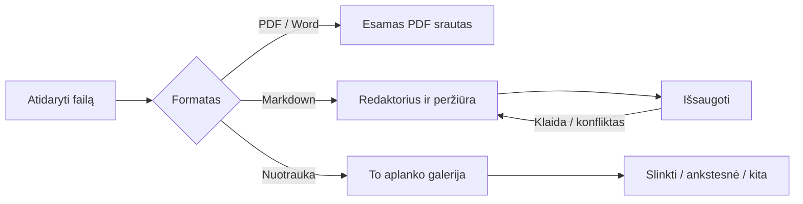

# Folio: Markdown redaktorius ir aplanko nuotraukų peržiūra

Statusas: vartotojas patvirtino apimtį 2026-11-09; vyksta įgyvendinimas.

## Tikslas ir sutarti poreikiai

Vienoje Folio programoje atidaryti PDF, Markdown ir nuotraukas. Atidarius vieną nuotrauką iš aplanko,
kuriame yra 20 nuotraukų, galima peržiūrėti visas tame aplanke esančias nuotraukas.
Vartotojas patvirtino: Markdown failus reikia ir skaityti, ir redaguoti bei išsaugoti.

Toliau pateiktą pirmos versijos apimtį vartotojas patvirtino prieš įgyvendinimą.

## Pirmos versijos apimtis

- Išlieka esamas PDF skaitytuvas ir Word konvertavimas į PDF.
- Markdown: `.md` ir `.markdown`, UTF-8, įskaitant UTF-8 BOM.
- Nuotraukos: `.jpg`, `.jpeg`, `.png`, `.webp`, `.gif`, `.bmp`, `.avif`.
  HEIC, TIFF, RAW, video ir archyvai į šį etapą neįtraukti; jų palaikymas nėra pažadėtas.
- Tie patys skirtukai, šviesi ir tamsi tema bei programos valdiklių stilius.
  Naujo vizualinio identiteto ar failų tvarkyklės nekuriame.
- Failų pasirinkimas, drag-and-drop ir operacinės sistemos „Open With“ turi veikti naujiems formatams.
  Palaikymas pridedamas kaip galimybė; nekeičiamas numatytasis kitų programų atidarymas.

## Markdown srautas

Atidaryti failą → skaityti arba redaguoti → matyti peržiūrą → išsaugoti tame pačiame faile.

- Platesniame lange redaktorius ir peržiūra yra greta. Siaurame lange jie perjungiami.
- Paprastas teksto redaktorius su įprastu undo/redo, antraštėmis, sąrašais,
  nuorodomis, kodo blokais ir esamu matematinių formulių atvaizdavimu peržiūroje.
  GitHub lentelės ir užduočių sąrašai nėra pirmos versijos pažadas.
- `Cmd+S` / `Ctrl+S` ir aiškus „Save“ mygtukas. Iki sėkmingo įrašymo skirtukas žymi pakeitimus.
- Uždarant pakeistą failą siūloma „Save“, „Discard“ arba „Cancel“; uždarant visą programą pakeitimai
  taip pat negali būti tyliai prarasti. Nesėkmingas išsaugojimas palieka redaktorių atidarytą.
- Jei failas diske pakeistas kitoje programoje, neperrašyti jo tyliai: pasiūlyti išsaugoti kopiją
  arba įkelti failą iš naujo su aiškiu neišsaugotų pakeitimų atsisakymu.
- Tik skaitymui skirtame aplanke galima išsaugoti kopiją. Atšauktas dialogas nekeičia dokumento.
- Išsaugant išlaikyti UTF-8 BOM, jei jis buvo, ir pradinį eilučių pabaigos formatą.
- Peržiūra nevykdo HTML ar skriptų. Vietinius santykinius paveikslėlius skaityti tik pasirinkto failo
  aplanko ribose; nuotolinių paveikslėlių automatiškai neatsisiųsti. Išorinės nuorodos atidaromos tik paspaudus.
- Tuščias failas yra tinkamas dokumentas. Ne UTF-8 ar per didelis failas rodo suprantamą klaidą.
  Siūloma Markdown riba: 5 MiB; redagavimas neatlieka automatinio įrašymo į originalą.

## Nuotraukų srautas

Finder / failų pasirinkimas / drag-and-drop → viena nuotrauka → to aplanko galerija viename skirtuke.

- Pagrindinė peržiūra: vertikaliai slenkama nuotraukų seka, pradžioje ties pasirinkta nuotrauka.
  Rodomas aktyvaus failo vardas ir skaitiklis, pavyzdžiui, „7 / 20“.
- Rodyklės ir klavišai ← / → perkelia prie ankstesnės / kitos nuotraukos. Pasiekus kraštą sustojama.
- Paveikslėliai telpa lango plotyje; yra „Fit“ ir „100%“ peržiūra. Priartintą paveikslėlį galima slinkti.
- Įtraukiami tik tiesioginiai to paties aplanko palaikomi failai, be poaplankių ar simbolinių nuorodų.
  Natūrali vardų tvarka: `foto2` prieš `foto10`, sutampančius vardus deterministiškai atskiriant visu vardu.
- Aplanko sąrašas gaunamas atidarant; skaitymas iš naujo atliekamas per „Refresh“ ir išlaiko pasirinktą failą,
  jei jis dar yra. Nuolatinio failų stebėjimo tarnybos nereikia.
- Įkeliamos tik matomos ir gretimos nuotraukos, atlaisvinami nutolusių vaizdų ištekliai.
  Neįkelti viso aplanko originalų į atmintį. Kiekvieną failą riboti iki 100 MiB ir 80 mln. pikselių.
- Sugadintas, pašalintas ar neperskaitomas paveikslėlis rodo klaidą savo vietoje; likusi galerija veikia.
  Yra „Retry“, be automatinio begalinio kartojimo. Vienas failas taip pat yra tinkama galerija.
- Ši versija nuotraukų neredaguoja ir nekeičia originalų.

## Įgyvendinimo ribos

- Išlaikyti `DocumentTabs`, dokumentų iframe izoliaciją ir esamą PDF `App` srautą.
  Dokumento tipą nustatyti prieš siunčiant į PDF skaitytuvą; naujus skaitytuvus parinkti bendrame atidarymo kelyje.
- Desktop Markdown dokumento tapatybę nustatyti pagal pagrindinio proceso patvirtintą failą, galerijos — pagal
  aplanką. Vienodo turinio skirtingi Markdown failai lieka atskiri. Pakartotinai atidarius tą patį failą
  aktyvuoti esamą skirtuką ir išlaikyti neišsaugotus pakeitimus; atidarius kitą to paties aplanko nuotrauką
  aktyvuoti esamą galeriją ties ja. Naujų formatų identifikatorių nenaudoti PDF recent ar paskutinio PDF atkūrimui.
- Visus įėjimus tikrinti kartu: `src/App.tsx` failų pasirinkimą ir drop, `src/documentTabs.ts`,
  `src/main.tsx`, `electron/main.cjs` argv / `open-file` / `second-instance`, preload ir `src/desktop.d.ts`.
- Aplankų skaitymas ir originalų įrašymas vyksta Electron pagrindiniame procese. Renderer negali perduoti
  savavališko disko kelio: jis naudoja pagrindinio proceso suteiktą atidaryto dokumento / galerijos identifikatorių.
  Uždaręs skirtuką pagrindinis procesas panaikina jo prieigą. Išlaikyti esamą IPC siuntėjo patikrą ir CSP.
- Išsaugojimas turi nepalikti dalinai perrašyto originalo; naudoti laikiną failą tame pačiame aplanke ir pakeitimą.
  Išlaikyti originalo teises; simbolinių nuorodų ir išorinio pakeitimo konfliktus spręsti prieš įrašymą.
- Naudoti esamus React, react-markdown, math ir CSS išteklius; AI atsakymų citatų logikos netaikyti Markdown failams.
  Naujų priklausomybių kol kas nenumatyta.
- Failų asociacijos: `package.json` macOS / Windows / Linux ir Linux MIME integracija, su patikra kiekvienai OS.
- Naršyklės versija atidaro tik aiškiai pasirinktus failus; prieigos prie gretimų aplanko failų nežada.
  Markdown „Save“ joje atsisiunčia kopiją. Pilnas aplanko ir įrašymo į originalą srautas yra desktop funkcija.
- Esamas PDF recent / anotacijų / AI saugojimas išlieka. Naujų formatų history ir Ask AI neplėsti šiame etape.

## Patikra ir perdavimas

- Markdown E2E: atidaryti, redaguoti, peržiūrėti, išsaugoti ir iš naujo atidaryti; įrašyti tuščią failą;
  ilgą tekstą; klaidingą koduotę; per didelį failą; HTML / skripto tekstą; nepavykusį įrašymą;
  atšaukimą; išorinį pakeitimą; uždarymą su pakeitimais; kelių skirtukų izoliaciją.
- Tapatybės E2E: skirtingi vienodo turinio Markdown failai lieka atskiri; pakartotinai atidarytas tas pats
  failas išlaiko redagavimą; kitos nuotraukos tame pačiame aplanke atidarymas parenka esamą galeriją;
  naujų formatų atidarymas nesugadina paskutinio PDF atkūrimo.
- Galerijos E2E: aplankas su 20 įvairių formatų nuotraukų ir nesusijusiais failais; atidaryti vidurinę;
  slinkti ir naudoti klavišus iki abiejų kraštų; natūrali tvarka; vienas failas; ištrintas / sugadintas failas;
  neleistinos prieigos klaida; didelė raiška; keli atskiri aplankai; refresh po pakeitimo.
- Naujų disko operacijų testai: perėjimo už aplanko ribų, savavališko kelio, simbolinių nuorodų,
  dydžio ribų ir išsaugojimo klaidų atvejai. Tikrinti pagal projekto `test:reader-security` modelį.
- `npx tsc --noEmit`, `npm run build`, `npm run smoke`, paveiktos regresijos ir nauji E2E; realaus desktop
  rendererio patikra naudojant projekto nematomą Electron / Playwright harness, neatidarant matomo lango be prašymo.
- Siauras ir platus langas, šviesi / tamsi tema, matomas fokusas ir klaviatūra. PDF / Word regresija privaloma.
  macOS rezultatai nėra Windows / Linux patikros įrodymas.
- Prieš įgyvendinimą nėra `node_modules` ir `.git`; nekurti saugyklos, commit, push ar viešo leidimo be prašymo.
- Tikslas – patikrinta vietinė versija vartotojo Mac. Bandymams naudoti atskirą programos kopiją ir profilį,
  išsaugant dabar įdiegtą Folio. Atskira vietinės kopijos tapatybė ir išjungtas oficialaus Folio auto-update
  turi neleisti tiek profilių konfliktui, tiek vietinių papildymų praradimui per upstream atnaujinimą.
  Viešas trijų platformų leidimas lieka atskira autorizuojama užduotis pagal `npm run release` taisykles.

## Patvirtinimas

Patvirtinti šią apimtį prieš produkto įgyvendinimą. Ypač: vertikali galerija su rodyklėmis,
pradinis formatų sąrašas be HEIC / TIFF / RAW ir vietinė atskira Folio kopija.

## Nepriklausoma dizaino peržiūra

Du kritikai ir atskiras vertintojas peržiūrėjo apimtį bei integracijos kelius.
B1 (privalomas): patikslinta failo / aplanko tapatybė ir atskyrimas nuo PDF sesijos; įtraukti E2E kriterijai.
R1 (neprivalomas): jei lieka atnaujinimo / restart veiksmas, papildomai patikrinti neišsaugotų pakeitimų atšaukimą.
R2 (neprivalomas): papildomai akcentuoti, kad šio vietinio etapo runtime įrodymai apims tik macOS.
Ši peržiūra patvirtina plano nuoseklumą, ne dar nesukurtos funkcijos veikimą.
